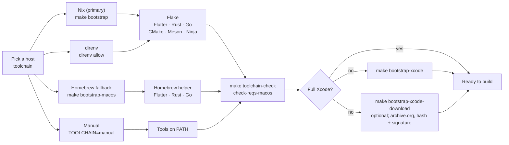
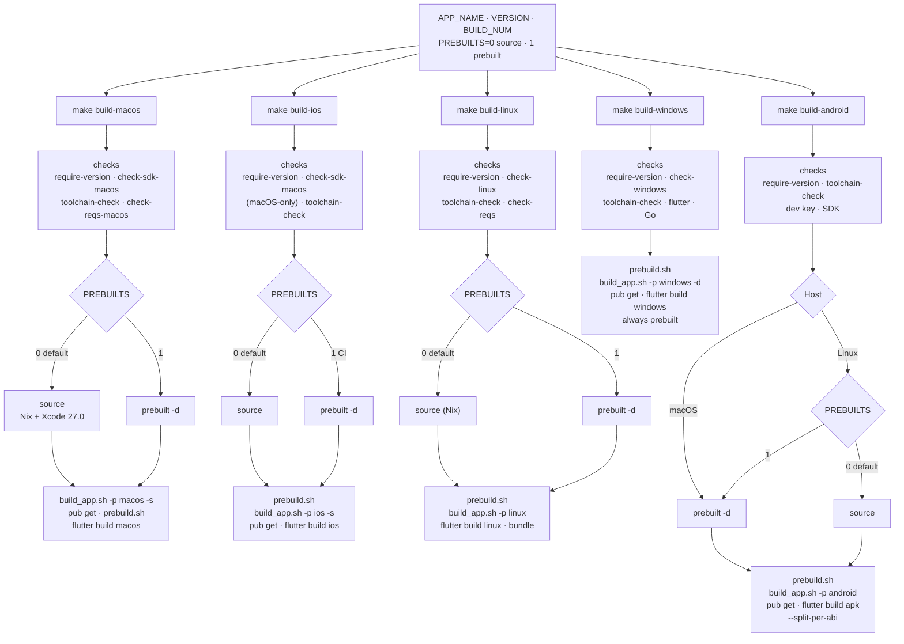

# Make build flow

This page is the maintained source for the two build-flow diagrams. GitHub
renders the Mermaid blocks directly; PNGs can be generated locally from the
same blocks (they are not committed). Keep the source in sync with the
`Makefile`.

## 1. Get the tools (once per Mac)

Nix is the primary host toolchain. direnv is not a separate toolchain: the
tracked `.envrc` is `use flake`, so it activates the same shell as
`nix develop`. Homebrew and manually installed tools are supported fallbacks.

### History

`.envrc` was added on 2026-03-17 as a 98-line script that installed Rust
toolchains, set `SDKROOT`/`CC`, created a Python venv and wrote `lipo`/`xcrun`
wrappers. On 2026-03-19 the commit `macos build: split bootstrap from
host-agnostic build path` (428fd61f9) reduced it to `use flake`; the flake and
Makefile took over those steps. That is why direnv is not a fourth toolchain
today. The Homebrew helper still installs the `direnv` binary, but `.envrc`
now skips the flake when Nix is absent, so a Homebrew-only shell is not
blocked.



`make bootstrap-xcode` does not install Xcode. It selects an existing full
install and finishes Apple's licence/first-launch setup if it is pending; the
archive.org download is opt-in and never runs in CI.

## 2. Build

`VERSION` and `BUILD_NUM` are required. dnix source is the default on macOS,
Linux and iOS; CI and Windows use the verified prebuilts.



## Defaults

| Context | `PREBUILTS` | dnix mode |
|---|---|---|
| macOS developer | `0` | source, verified; needs Nix + Xcode 27.0 |
| Linux developer | `0` | source, verified; needs Nix |
| iOS developer | `0` | source, verified; needs Nix + Xcode 27.0 |
| macOS/Linux/iOS CI | `1` | verified prebuilts (`-d`) |
| Windows | `1` (fixed) | verified prebuilts (`-d`) |
| Android on macOS | `1` (fixed) | verified prebuilts (`-d`) |
| Android on Linux | follows `PREBUILTS` | source by default |

## Regenerating the PNGs

Extract the two Mermaid blocks and render them with Mermaid CLI:

```sh
npx --yes @mermaid-js/mermaid-cli -i make-flow-tools.mmd \
  -o make-flow-tools.png -t dark -b "#0d1117" --size 1800 -s 2
npx --yes @mermaid-js/mermaid-cli -i make-flow-build.mmd \
  -o make-flow-build.png -t dark -b "#0d1117" --size 1800 -s 2
```
