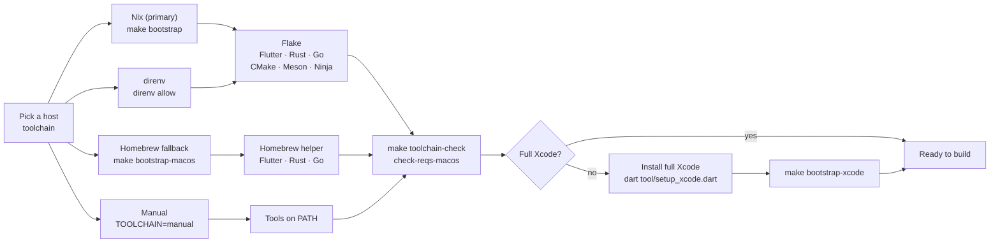
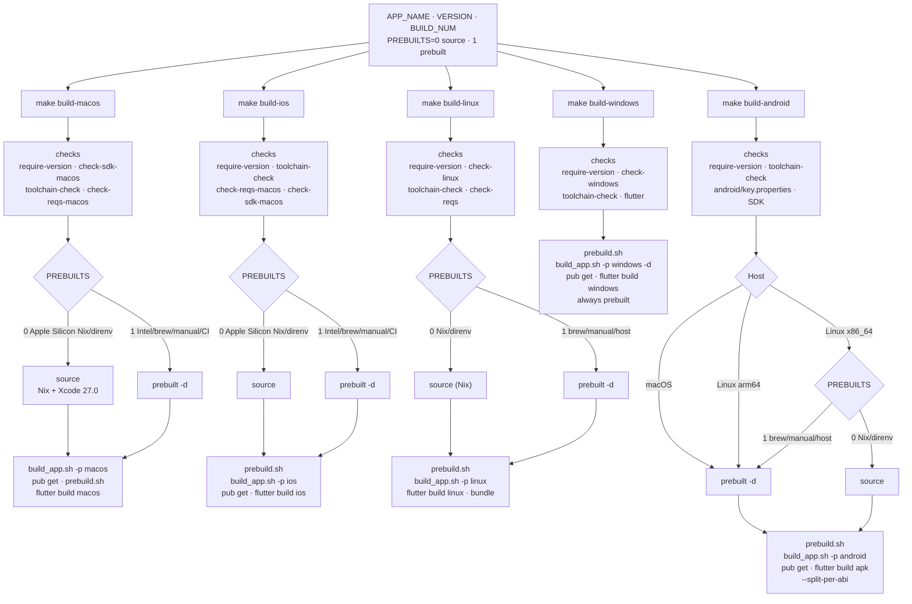

# Make build flow

This page is the maintained source for the two build-flow diagrams. GitHub
renders the Mermaid blocks directly; keep the source in sync with the
`Makefile`.

## 1. Get the tools (once per Mac)

Nix is the primary host toolchain. direnv is not a separate toolchain: the
tracked `.envrc` is `use flake`, so it activates the same shell as
`nix develop`. Homebrew and manually installed tools are supported fallbacks.

### History

`.envrc` started as a standalone environment script; it was reduced to
`use flake` when the flake and Makefile took over the host setup. That is why
direnv is the Nix activator, not a fourth toolchain. The Homebrew helper still
installs the `direnv` binary, but `.envrc` skips the flake when Nix is absent,
so a Homebrew-only shell is not blocked.

`make bootstrap-xcode` does not install Xcode. It selects an existing full
install; when it changes the selection it accepts the licence and runs pending
first-launch setup. An already-selected Xcode is left untouched. Use
`dart tool/setup_xcode.dart` or Apple's download page to install one.

## 2. Build

`VERSION` and `BUILD_NUM` are required. dnix source is only available through
the Nix/direnv toolchain: it is the default on Apple Silicon macOS and inside
Nix/direnv on Linux. Homebrew, manual and host toolchains, Intel macOS, CI and
Windows use the verified prebuilts.

## Defaults

| Context | `PREBUILTS` | dnix mode |
|---|---|---|
| macOS developer, Apple Silicon, Nix/direnv | `0` | source, verified; needs Xcode 27.0 |
| macOS developer, Apple Silicon, brew/manual/host | `1` | verified prebuilts (`-d`); source needs Nix/direnv |
| macOS developer, Intel | `1` | verified prebuilts (`-d`) |
| Linux developer in Nix/direnv | `0` | source, verified |
| Linux developer, brew/manual/host | `1` | verified prebuilts (`-d`); source needs Nix/direnv |
| iOS developer, Apple Silicon, Nix/direnv | `0` | source, verified; needs Xcode 27.0 |
| iOS developer, Apple Silicon, brew/manual/host | `1` | verified prebuilts (`-d`) |
| iOS developer, Intel | `1` | verified prebuilts (`-d`) |
| macOS/Linux/iOS CI | `1` (explicit `-d`) | verified prebuilts (`-d`) |
| Windows | `1` (fixed) | verified prebuilts (`-d`) |
| Android on macOS | `1` (default; source needs x86_64 Linux in Nix/direnv) | verified prebuilts (`-d`) |
| Android on x86_64 Linux in Nix/direnv | follows `PREBUILTS` | source by default |
| Android on x86_64 Linux, brew/manual/host | `1` | verified prebuilts (`-d`); source needs Nix/direnv |
| Android on non-x86_64 Linux | `1` (default; source needs x86_64 Linux in Nix/direnv) | verified prebuilts (`-d`) |
